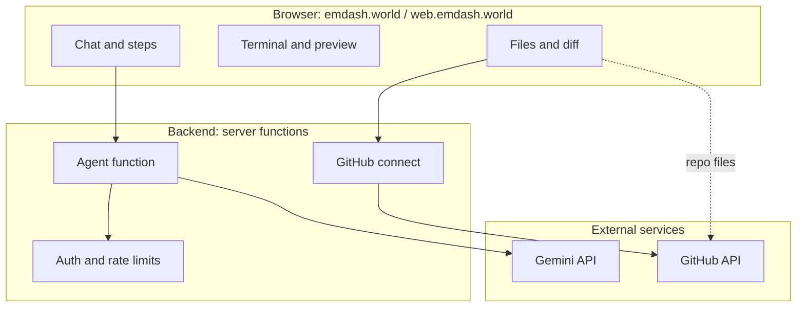

<div align="center">

<picture>
  <source media="(prefers-color-scheme: dark)" srcset="public/assets/emdash-wordmark-dark.png">
  
</picture>


Free, open-source AI app builder and web coding agent.<br>
Describe what you want, preview it live, iterate in chat, and keep the code.

[](https://emdash.world)
[](#project-status)
[](LICENSE)
[](#contributing)

[Website](https://emdash.world) · [Preview deployment](https://emdashworld.vercel.app) · [Report a bug](../../issues/new) · [Request a feature](../../issues/new)

</div>

---

## Table of contents

- [Overview](#overview)
- [Products](#products)
- [Features](#features)
- [Project status](#project-status)
- [How Emdash stays free](#how-emdash-stays-free)
- [Architecture](#architecture)
- [Tech stack](#tech-stack)
- [Getting started](#getting-started)
- [Environment variables](#environment-variables)
- [Deployment and domains](#deployment-and-domains)
- [Project structure](#project-structure)
- [Design system](#design-system)
- [Roadmap](#roadmap)
- [Contributing](#contributing)
- [Security](#security)
- [Sponsors](#sponsors)
- [License](#license)

## Overview

Every great product started as a sentence someone wasn't sure they could build. Emdash exists for that moment.

You describe an idea in plain language. Emdash plans it, builds it in front of you, and shows a live preview. You keep refining it by chatting, then export the code or publish it. The code is yours from the first line.

The name comes from the em dash, the punctuation mark that connects one thought to the next. That is the whole job: connect what you imagine to what exists.

**Principles**

- **Free.** No paywall between you and your first idea.
- **Open source.** You should be able to read how your builder works.
- **Honest.** Clearly labeled sponsor slots fund the project. Nothing is hidden.

## Products

| Product | What it does | Where |
| --- | --- | --- |
| **Emdash Builder** | Turn a prompt into a working web app, landing page, or interactive tool with live preview and export | [emdash.world](https://emdash.world) |
| **Emdash Web Agent** | An open-source coding agent in the browser. Connect GitHub, describe a change, review the diff, open a pull request | `web.emdash.world` (planned) |

## Features

**Builder**

- Prompt-to-app generation from a single text box
- Plan-then-build pipeline: design brief, file plan, code, validation, automatic repair
- Exact honoring of the colors, fonts, and layout you describe, using design tokens
- Output as `index.html`, `style.css`, `app.js`, or React + TypeScript + Tailwind for richer apps
- Live preview with desktop, tablet, and mobile widths
- Version history for every change
- Export the code, publish to a free subdomain

**Web Agent**

- GitHub sign-in and repository browser
- Agent that reads, searches, edits, and tests your repo
- Works on its own branch and never pushes to `main`
- Diff review, then commit and open a pull request
- Terminal and preview that run in your browser

**Experience**

- Clean, minimal interface with light and dark themes
- Keyboard-friendly and accessible, respects `prefers-reduced-motion`
- Responsive down to mobile

## Project status

Emdash is at an **early stage**. This table separates what exists from what is planned.

| Area | Status |
| --- | --- |
| Landing page, templates grid, sponsor slots | Live at [emdash.world](https://emdash.world) |
| Builder UI prototype (prompt, chat, preview) | Prototype |
| Generation pipeline (brief, plan, build, repair) | In progress |
| Web Agent UI (`/web`) | In progress |
| GitHub connect and repo access | Planned |
| In-browser terminal and preview runtime | Planned |
| Publish to subdomain | Planned |

## How Emdash stays free

Emdash is funded by **clearly labeled sponsor slots**, and only by those.

- Sponsor placements are marked "Ad" or "Sponsored".
- They appear on the landing page, around the composer, and in sidebars.
- They never appear inside your code, your files, your terminal, or the apps you build.

Interested in sponsoring? See [Sponsors](#sponsors).

## Architecture



Key ideas:

1. **Keys stay on the server.** Model API keys are never sent to the browser or committed to the repo.
2. **Plan first, then build.** The generation pipeline creates a design brief and file plan before writing code, then validates the result and repairs errors automatically.
3. **Design tokens.** Colors and fonts from the brief are injected as CSS variables by the platform, so your palette is always applied exactly.
4. **Safe by default.** The web agent edits a separate branch, asks for approval before shell commands, and opens a pull request instead of pushing to `main`.
5. **Sandboxed previews.** Generated apps run in an iframe with restricted permissions.

## Tech stack

| Layer | Choice |
| --- | --- |
| Hosting | Vercel (current), custom domain `emdash.world` |
| Frontend | TypeScript, React, Tailwind CSS |
| Model provider | Google Gemini API (server-side) |
| In-browser runtime | Sandpack or WebContainers (to be confirmed) |
| Auth and data | Supabase (planned) |
| GitHub integration | GitHub App (planned) |

> Update this table to match the exact framework and libraries used in the repository.

## Getting started

### Prerequisites

- Node.js 20 or newer
- npm, pnpm, or yarn
- A Gemini API key (only needed to run the generation pipeline locally)

### Install and run

```bash
# 1. Clone
git clone https://github.com/<your-username>/emdash.git
cd emdash

# 2. Install dependencies
npm install

# 3. Configure environment variables
cp .env.example .env.local

# 4. Start the development server
npm run dev
```

Open <http://localhost:3000>.

### Scripts

| Command | What it does |
| --- | --- |
| `npm run dev` | Start the development server |
| `npm run build` | Create a production build |
| `npm run start` | Serve the production build |
| `npm run lint` | Run the linter |

## Environment variables

Create `.env.local` (never commit it):

```bash
# Server-side only. Never expose this to the browser.
GEMINI_API_KEY=
GEMINI_MODEL=

# Site
NEXT_PUBLIC_SITE_URL=https://emdash.world

# Planned: auth, database, GitHub App
SUPABASE_URL=
SUPABASE_SERVICE_ROLE_KEY=
GITHUB_APP_ID=
GITHUB_APP_PRIVATE_KEY=
```

Security reminders:

- Keep `.env*` files in `.gitignore`.
- Do not put keys in client code, logs, or screenshots.
- If a key is ever exposed, revoke it and create a new one right away.

## Deployment and domains

Emdash currently deploys on Vercel. The preview deployment is at [emdashworld.vercel.app](https://emdashworld.vercel.app), and the production domain is **[emdash.world](https://emdash.world)**.

1. Import the repository into Vercel.
2. Add the environment variables above in **Project Settings → Environment Variables**.
3. In **Settings → Domains**, add `emdash.world` and `www.emdash.world`.
4. Add the DNS records Vercel shows you at your domain registrar.
5. Set one domain as primary and redirect the other to it.
6. Keep the canonical URL as `https://emdash.world/` (already set in the site metadata).

Planned subdomains:

| Subdomain | Purpose |
| --- | --- |
| `emdash.world` | Main site and Builder |
| `web.emdash.world` | Web Agent |
| A separate domain for published apps | User-built sites, kept apart from the main domain for security |

## Project structure

A suggested layout (adjust to the actual repository):

```
emdash/
├─ app/ or src/
│  ├─ page.tsx             # Landing page
│  ├─ builder/             # Prompt, chat, preview
│  ├─ web/                 # Web Agent UI
│  └─ api/                 # Server routes / functions
├─ components/
│  ├─ ui/                  # Shared primitives
│  ├─ sponsor-slot.tsx
│  └─ founder-note.tsx
├─ lib/
│  ├─ pipeline/            # brief -> plan -> build -> validate -> repair
│  └─ tokens.ts            # design token injection
├─ public/
│  └─ assets/
│     ├─ emdash-wordmark.png       # Dash icon + name, for light backgrounds (README header)
│     ├─ emdash-wordmark-dark.png  # Dash icon + name, for dark backgrounds
│     └─ emdash-logo.png           # Orange dash icon only
├─ .env.example
└─ README.md
```

## Design system

Emdash has a distinct visual identity. Please follow it in contributions.

- **Brand color:** orange `#ff5401`
- **Surfaces:** white and light gray, with thin 1px borders and square-ish corners
- **Details:** mono uppercase labels, crop-mark corner brackets, hatched divider bands, dashed sponsor slots with an "AD" badge
- **Themes:** light and dark
- **Accessibility:** 4.5:1 text contrast, visible focus rings, reduced-motion support
- **Logo:** the orange dash with the "Emdash" name on the same line, vertically centered. Use `public/assets/emdash-wordmark.png` on light backgrounds and `emdash-wordmark-dark.png` on dark ones. `emdash-logo.png` is the dash icon alone. Keep clear space, and don't recolor, stretch, or rotate it.

### Typography

| Font | Use | Weights |
| --- | --- | --- |
| [Plus Jakarta Sans](https://fonts.google.com/specimen/Plus+Jakarta+Sans) | Headings and body text | 400, 500, 600, 700 |
| [JetBrains Mono](https://fonts.google.com/specimen/JetBrains+Mono) | Code and small uppercase labels (`FREE`, `SPONSORED`) | 400, 500 |

```html
<link
  href="https://fonts.googleapis.com/css2?family=JetBrains+Mono:wght@400;500&family=Plus+Jakarta+Sans:wght@400;500;600;700&display=swap"
  rel="stylesheet"
/>
```

```css
body { font-family: 'Plus Jakarta Sans', system-ui, sans-serif; }
code, .label { font-family: 'JetBrains Mono', ui-monospace, monospace; }
```

Headlines use tight letter spacing. Body text and labels use normal spacing.

## Roadmap

- [x] Landing page and templates grid
- [x] Sponsor slot system
- [ ] Generation pipeline with automatic repair
- [ ] Builder: version history, export as zip
- [ ] Publish to a free subdomain
- [ ] Web Agent UI at `/web`
- [ ] GitHub App connect and repo browser
- [ ] Agent tools: read, search, edit, run, commit
- [ ] Pull request flow with diff review
- [ ] In-browser terminal and live preview
- [ ] Community templates
- [ ] Documentation site

## Contributing

Contributions are welcome and appreciated.

1. Fork the repository and create a branch: `git checkout -b feat/your-feature`
2. Make your change and run `npm run lint` and `npm run build`
3. Commit with a clear message
4. Open a pull request that explains what changed and why

For larger changes, please open an issue first so we can discuss the approach.

**Good first contributions:** accessibility fixes, new templates, documentation, and design polish that follows the [design system](#design-system).

## Security

If you find a security problem, please **do not** open a public issue. Email `security@emdash.world` (placeholder: set up this address) with the details, and we'll respond as soon as we can.

## Sponsors

Emdash is supported by sponsors whose placements are always clearly labeled.

Want to sponsor a slot? Reach out at `sponsors@emdash.world` (placeholder: set up this address).

## License

Released under the [MIT License](LICENSE). Add a `LICENSE` file to the repository root before publishing.

---

<div align="center">

**Founded by KETAN** · [@ketanofc](https://x.com/ketanofc)

Free to start. Open to read. Yours to keep.

[emdash.world](https://emdash.world)

</div>
